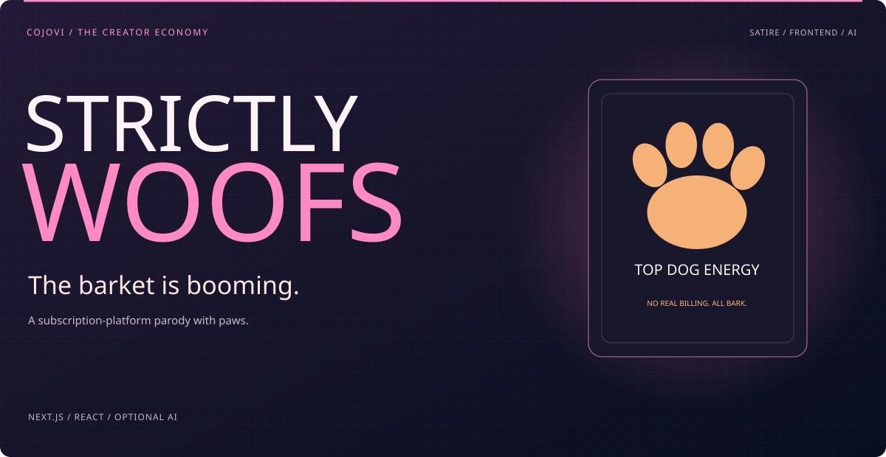

<picture>
  <source media="(max-width: 640px)" srcset="readme-assets/showcase-cover-mobile.svg">
  
</picture>

# Strictly Woofs

**The creator economy has officially gone to the dogs.**

Strictly Woofs is a satirical creator-platform demo starring a roster of outrageously self-important canine influencers. There are feeds, profiles, mock subscriptions, messages, simulated live rooms, and—when configured—AI-generated creator replies. There are also entirely too many opinions about treats.

A [Cody / COJOVI](https://github.com/cojovi) project, built with Next.js, React, TypeScript, and a sense that the internet probably needed adult supervision.

[Meet the pack ↗](https://strictly-woofs-com-1kjh.vercel.app/) · [The punchline](#the-punchline) · [Behind the bark](#behind-the-bark) · [Run locally](#run-locally) · [Source map](#source-map)

`Next.js` · `React` · `TypeScript` · `Optional OpenAI integration` · `Upstash Redis`

> **The financial model is 100% imaginary.** Sign-in and signup are demo flows. Tips and subscriptions do not process payments or enforce access. The live room is simulated. Do not enter real passwords, payment details, or sensitive conversations.

## The punchline

<table>
<tr>
<td width="43%"></td>
<td><strong>Meet Max Muscles.</strong><br>He is a fictional influencer. He has a fitness brand, a dramatic relationship with snacks, and an absolutely unreasonable amount of confidence.<br><br>Strictly Woofs takes familiar platform features—creator profiles, feeds, tips, messages, and status updates—and puts them to work for a cast of dogs who have apparently hired publicists.<br><br><strong>Is it serious business?</strong> Only if your accountant accepts belly rubs.</td>
</tr>
</table>

The humor is the product direction. Underneath it are real application decisions: how to route profiles, persist a demo interaction, coordinate optional AI requests, and avoid treating fake payments as real ones.

## What the pack can do

- **Creator profiles:** a shared [fixture catalog](src/lib/mockData.ts) supplies profile data and generated routes. Some dogs have more personal branding than actual marketable skills.
- **Feed and mock subscriptions:** like, comment, and toggle fictional subscriptions. The browser stores selected demo state, including mock transactions; no billing provider is involved.
- **Messages and simulated live rooms:** conversation and chat interfaces provide the illusion of a very busy dog influencer economy. The live room is not a video broadcast.
- **Optional creator AI:** with server-side provider and Redis configuration, an API route can generate in-character text for posts or chats. Without that configuration, those calls report unavailable; the rest of the demo can still be explored.
- **Presence-aware shared updates:** visitor heartbeats, an expiring lock, and a shared schedule coordinate optional generated posts. A dog can have a content calendar, apparently.

## Behind the bark

```text
Creator fixtures + App Router pages
          ↓                       ↘
Browser demo interactions      Optional server routes
localStorage / sessionStorage  /api/creator + /api/presence
                                      ↓
                               OpenAI + Upstash Redis
```

### 01 / A cast, not a collection of hardcoded pages

A central [creator catalog](src/lib/mockData.ts) drives generated profile paths and display content. The [profile route](src/app/creator/%5Busername%5D/page.tsx) resolves a creator and hands it to a client component for interactive UI. The result is one reusable page pattern with a whole cast of personalities.

### 02 / A fake economy with real state boundaries

[Browser storage helpers](src/lib/mockStorage.ts) persist selected demo interactions, conversations, and mock transactions locally. [Feed](src/app/feed/page.tsx), [messages](src/app/messages/page.tsx), and [live](src/app/live/page.tsx) are separate interfaces with different state and timers. An image overlay is presentation, not access control; a subscription button is part of the joke, not an authorization system.

### 03 / Optional AI with a server-side gate

The [creator API](src/app/api/creator/route.ts) checks the request origin, validates the requested creator and mode, bounds the chat history it forwards, and checks a shared rate limiter before calling the provider. The [adapter](src/lib/creatorAI.ts) requests short, character-specific text and sets `store: false` on the provider request. It returns an error when the provider is unavailable; generated text still needs review.

### 04 / One shared schedule, many visitors

The [presence service](src/lib/presence.ts) uses Redis scripts to track expiring visitor heartbeats and claim a single scheduled generation lock. The [presence route](src/app/api/presence/route.ts) checks for an active visitor and rate-limit budget before optional generation, then stores a bounded list of shared posts. If shared storage is unavailable, the routes fail closed rather than silently bypassing the limit.

This is a personal satire and an integration experiment. It is not a production-ready social network, and no real user base, revenue, or provider-quality benchmark is claimed.

## Run locally

You need Git, [Bun](https://bun.sh/), and a compatible Node.js version. The commands below use the tracked Bun lockfile and bind the development server to your own machine:

```bash
git clone https://github.com/cojovi/Strictly_Woofs.git
cd Strictly_Woofs
bun install --frozen-lockfile
bunx next dev --hostname 127.0.0.1 --port 3000
```

Open <http://127.0.0.1:3000>. You can explore the mock interface without providing AI credentials. The root layout loads an external `same-runtime` script, and some images are remote; this is not a fully offline app.

**Optional AI and shared presence:** the server reads `OPENAI_API_KEY`, optional `OPENAI_MODEL`, and `KV_REST_API_URL` / `KV_REST_API_TOKEN`. Keep credentials server-side and out of Git. Provider requests can incur costs, and visiting active sections can send presence heartbeats that may initiate scheduled AI generation when configured. Review the [creator](src/app/api/creator/route.ts) and [presence](src/app/api/presence/route.ts) routes before enabling these services.

The tracked `package-lock.json` is out of sync with the current `package.json`; `npm ci` failed during this review. Use the Bun lockfile above until the npm lockfile is reconciled. The configured `dev` script binds to `0.0.0.0`; the explicit command above keeps the local demo on loopback.

## Verification

The production build passed during this showcase review. The local landing page and a simulated feed like were exercised with AI and Redis credentials unset. Route tests passed when run in separate Bun processes, with provider/storage mocked:

```bash
bun test tests/creator-route.test.mjs
bun test tests/presence-route.test.mjs
bun run build
```

The two route test files currently interfere when run together because their module mocks overlap; that combined run produced one failure. Redis integration tests require an explicitly configured test store and were not run. No live AI request, real payment, authentication, or broadcast was tested.

## Source map

| Source | Why it matters |
|---|---|
| [Creator catalog](src/lib/mockData.ts) | Fictional profiles, feed fixtures, and character voices |
| [Profile route](src/app/creator/%5Busername%5D/page.tsx) | Generated paths and shared creator page |
| [Feed](src/app/feed/page.tsx) · [Messages](src/app/messages/page.tsx) · [Live](src/app/live/page.tsx) | Interactive parody interfaces |
| [Browser storage](src/lib/mockStorage.ts) | Local demo state and mock transactions |
| [Creator API](src/app/api/creator/route.ts) · [AI adapter](src/lib/creatorAI.ts) | Optional character replies and posts |
| [Rate limiter](src/lib/creatorRateLimit.ts) · [Presence](src/lib/presence.ts) | Shared limits, visitor heartbeats, and generation coordination |
| [Tests](tests/) | Mocked route checks and optional Redis integration tests |

## Fine print from the legal department's emotional-support golden retriever

Strictly Woofs is a parody. The fictional creators, prices, transactions, subscriber counts, and livestream presentation are not evidence of a functioning paid platform. The UI includes suggestive parody copy and references remote media; review both for your intended audience and usage rights. No repository-level license was found in this revision; public visibility does not itself grant reuse rights.

[Meet the pack ↗](https://strictly-woofs-com-1kjh.vercel.app/) · [More work](https://github.com/cojovi) · [Showcase font licenses](readme-assets/SHOWCASE-FONTS.txt)
